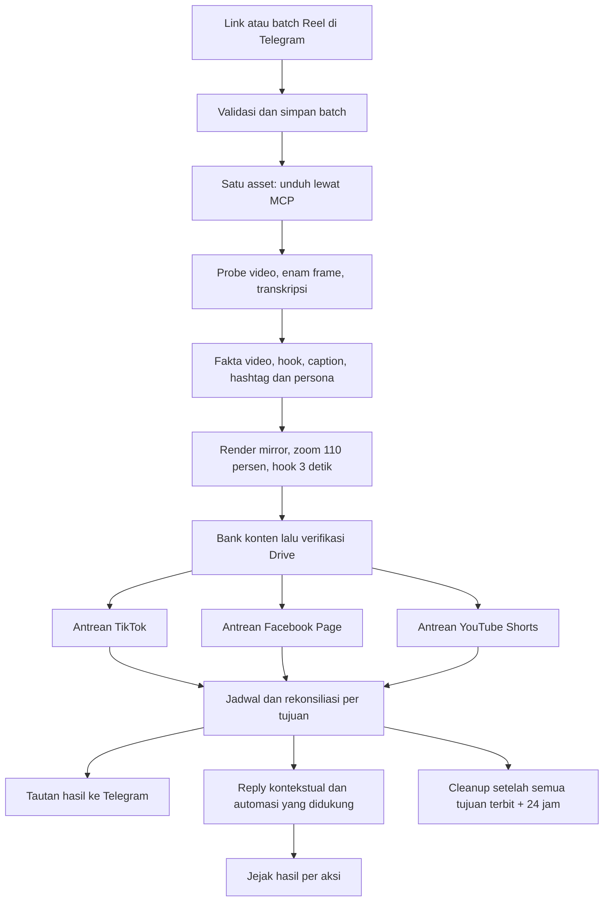

# Rencana implementasi paket Fahra Automation

Status 16 Oktober 2026: rancangan berdasarkan audit, belum ada worker baru yang aktif. Keputusan pengguna: satu link menuju tiga platform, maksimal 20 video per akun/hari WIB, akun baru otomatis ikut rotasi, paket menggantikan dua workflow lama setelah uji lulus.

## Alur yang dibangun

Hook dan caption dasar untuk metadata file disiapkan sebelum render final karena teks hook dibakar pada video. Editor awal memeriksa media; renderer akhir membuat hasilnya. Hook bersama mengikuti konteks video, tidak bergantung akun tujuan. Setelah akun dipilih, caption/judul/hashtag publik disesuaikan dengan persona akun tanpa merender ulang video bersama. Persona adalah profil gaya akun yang memengaruhi teks, bukan tahap membuat fakta baru.

## Struktur paket

Satu aplikasi Python baru `fahra_automation`, satu bot, dan satu SQLite operasional dengan migrasi schema. Modul: config/credentials, intake, account registry, asset worker, media, analysis, personas, Drive, scheduler, adapters, comments, notifications, cleanup, health, dan migration. Hindari tiga salinan pipeline atau pemasangan dua package peternakan ke venv yang sama.

Bot mewarisi penerimaan link publik, kontrol admin ID 265732518, serta rincian batch yang dibatasi pengirim/admin dari keputusan workflow sebelumnya. Pesan progres satu batch diperbarui dan hasil menyertakan tautan per tujuan. Batas batch/backlog dapat menunda penerimaan tanpa mengubah mode menjadi allowlist secara diam-diam.

| Data | Tanggung jawab dan invariant |
| --- | --- |
| batches dan sources | Telegram update/message dedupe, URL canonical, asal kiriman, daftar tujuan wajib tersimpan saat ingest |
| assets dan artifacts | Satu artifact resmi per revisi, lease asset, hash sumber/hasil, manifest Bank/Drive, capability media; komputasi lokal boleh diulang bila aman |
| deliveries | Unik asset + platform + revisi; akun, slot, metadata, marker, ID jadwal/post dan status independen |
| accounts dan account_snapshots | Platform/identitas/koneksi/capability, generation snapshot lengkap, cursor rotasi; histori tidak dihapus |
| reservations dan external_usage | Kuota per akun/tanggal WIB, jadwal eksternal, unique reservation; satu schedule tidak dihitung dua kali |
| attempts dan action_journal | Intent sebelum network mutation, fase request, hasil pasti/tidak pasti, rekonsiliasi dan identitas migrasi |
| personas dan bindings | Profil/version akun; snapshot versi yang dipakai setiap caption/draft |
| contexts, comments dan reply_attempts | Fakta video, thread induk, dedupe event/aksi, cutoff, native/custom ownership, hasil terverifikasi |
| outbox, events dan health | Pesan durable, histori append-only, status loop, error type, retry_at, ukuran backlog/disk |

ID eksternal selalu membawa platform dan account ID. ID record komentar Repliz tidak boleh tertukar dengan ID komentar platform. Marker baru membawa namespace proyek dan delivery ID; adapter rekonsiliasi tetap mengenali marker lama saat migrasi.

## Akun otomatis dan penjadwalan

1. Ambil seluruh halaman akun serta pemakaian jadwal terkait. Validasi total, halaman akhir, ID unik, platform, koneksi, dan format status. Terapkan akun, kuota, generation dan freshness dalam satu transaksi hanya setelah semua data lengkap.
2. Akun baru connected dan eligible masuk rotasi otomatis, mendapat persona default serta status kesiapan automasi. Tidak ada pendaftaran manual. Akun yang capability/permission-nya belum dapat diperiksa berstatus menunggu pemeriksaan, bukan dibuang. iq7fanspage tetap terlarang.
3. Akun disconnect keluar dari pilihan baru. Delivery yang belum punya intent dapat dialihkan pada platform sama. Submitting, unknown, scheduled dan published tetap terikat sampai rekonsiliasi selesai. Reconnect mempertahankan kuota dan cursor.
4. Pilih akun dengan beban eligible terendah dan cursor persisten untuk memecah seri. Tiap platform berjalan sendiri. Satu link tidak ditayangkan ke semua akun dalam platform yang sama.
5. Limit internal 20 video/akun/hari WIB; seluruh reserved, submitting/unknown, scheduled dan published yang memakai kuota diperhitungkan bersama jadwal eksternal. Hari dan slot yang berubah di remote direkonsiliasi tanpa menghitung ganda atau melepas slot secara buta.
6. Usulan jendela awal 08:00 sampai sebelum 23:00 WIB, 20 slot sekitar 45 menit, offset per akun tersimpan. Slot lampau tidak dikejar dengan burst. Link terlambat, stok kurang, provider limit, atau gangguan dapat membuat hasil kurang dari 20. Waktu API dikirim UTC, tampilan dan kuota memakai WIB.
7. Saat kuota satu platform penuh, hanya delivery platform itu bergeser hari. Pada inventaris saat audit, 100 link membutuhkan 100 delivery tiap platform: secara nominal YouTube 80 hari ini dan 20 besok, jika kuota kosong. Jangan menjanjikan 920 sumber/hari akan selesai di ketiga platform.

Usulan interval sync akun 300 detik, dengan pemeriksaan freshness/generation sebelum intent. Batas provider menjadi penundaan spesifik akun dan retry_at, bukan alasan memakai akun lain untuk menggandakan tujuan. Besaran cadence/health perlu dibuktikan melalui uji beban; batas API dan budget bersama seluruh modul memakai satu limiter.

## Media, caption dan persona

MCP tetap menjadi downloader Instagram. Dedup URL dan hash, pencatatan start request, serta rekonsiliasi download orphan mengurangi duplikasi akibat crash sesudah start sebelum ID tersimpan. MCP belum memiliki idempotency key; start ambigu yang tidak dapat dipetakan ditahan untuk pemulihan, bukan diklaim selalu bisa ditemukan. Pengulangan komputasi lokal yang aman boleh menghasilkan satu artifact resmi setelah validasi. `partial` tidak dianggap selesai penuh tanpa manifest file yang terbukti; kebijakan cleanup harus konsisten dengan keputusan penerimaan media.

Usulan profil bersama awal: 9:16, durasi 3–90 detik, H.264/yuv420p, AAC bila ada audio, faststart, batas ukuran paling ketat dari adapter. Rasio/durasi lain masuk evaluasi adaptasi; jangan crop bagian penting, memotong durasi, atau mengirim YouTube biasa tanpa keputusan yang sesuai. Video Shorts tetap perlu bukti klasifikasi platform. Ketentuan adapter ada di [matriks kemampuan](PLATFORM_CAPABILITIES.md).

Tahap AI memisahkan pengamatan fakta, ketidakpastian, lalu penulisan. Pertahankan confidence pengamatan, riwayat caption, dan model aktual; jangan menyediakan caption generik saat bukti kabur. TikTok/FB memakai caption dan hashtag Indonesia; YouTube memiliki title, description, hashtag, serta tags tersendiri. Persona boleh mengubah gaya dan reaksi, tidak mengubah fakta atau mengaku mengalami kejadian.

Persona default mengikuti gaya pengguna: santai/lucu Gen Z, singkatan seperlunya, 0–2 emoji bila cocok, lebih tenang untuk kabar serius. Per akun dapat diberi versi profil lain kemudian. Snapshot persona untuk caption/draft/jadwal tetap stabil setelah restart. Perubahan profil tidak mengubah posting terbit atau draft yang sudah dikirim secara diam-diam. Jika delivery belum memiliki intent lalu dialihkan ke akun lain, binding dan metadata persona lama dibatalkan dan disiapkan kembali sebelum intent. Render khusus persona, bila kelak diperlukan, harus menjadi revisi artifact tersendiri. Model tetap cx/gpt-6.1-sol diusulkan untuk konsistensi, dengan akses tetap dari 9Router pengguna.

## Komentar dan moderasi

Reply memakai fakta video, caption asli/hasil, konteks edit, teks komentar, thread induk, balasan yang sudah ada, persona/version, serta confidence. Nested comment tanpa parent context ditahan. Pemilihan reply/skip/review dilakukan sebelum pengiriman, dengan gaya sesuai situasi; bukan semua komentar wajib dibalas.

Satu pemilik reply per posting. Usulan: worker 9Router mengirim reply custom; native like/moderasi dipakai hanya pada platform pendukung setelah uji per capability. TikTok dan Facebook mendukung like komentar; YouTube tidak. YouTube native reply/moderasi hanya per posting, sehingga pemetaan konfigurasi otomatis terjadi ketika posting dibuat/terverifikasi. Override per posting harus memuat keseluruhan modul yang hendak dipertahankan.

Kuota reply awal 20/akun/hari adalah usulan terpisah dari kuota video. Kuota menunggu tidak menambah counter error. Jaringan/rate limit mendapat backoff; konten ambigu mendapat review. Timeout pengiriman menjadi send_unknown/sent_unverified dan direkonsiliasi, bukan dikirim ulang buta. Cutoff akun/post mencegah seluruh komentar lama tiba-tiba dibalas saat onboarding.

Moderasi memakai aturan spesifik seperti spam tautan/penipuan/ujaran yang dipilih kebijakan, bukan menghapus kritik atau komentar negatif umum. Simpan alasan dan hasil. Pada TikTok delete berarti hide; semantik YouTube harus dibuktikan. DM, follow/unfollow, aksi pada posting orang lain, dan pelaporan abuse tidak dimasukkan hanya karena disebut dll.

## Drive, kapasitas disk dan pemulihan

Simpan hasil secara atomik ke bank pilihan pengguna. Tunggu sinkronisasi Desktop, temukan Drive file ID yang benar, cocokkan ukuran dan seluruh checksum. Verifikasi penuh kembali sebelum setiap POST, termasuk delivery yang menunggu hari berikutnya. HTML/login, perubahan file, nama ganda, atau mismatch menahan delivery. Tidak beralih ke API upload alternatif secara otomatis.

Terima dan simpan URL lebih dahulu; download/render dibatasi horizon jadwal agar YouTube yang lambat tidak menumpuk semua MP4 sekaligus. Budget backlog, ruang minimum, konkurensi, dan batas batch harus konfigurabel dengan alasan menunggu yang terlihat. Usulan awal satu ekstraksi MCP, satu render aktif, dan horizon render 24 jam; ukur sebelum menaikkan.

Cleanup membaca daftar required destinations pada asset. Semua wajib published ditambah 24 jam dari yang terakhir, Drive/Bank utuh, frame tersedia, serta tidak ada referensi aktif/preview/arsip lama sebelum file kerja dapat dihapus. Histori/caption/transkrip/persona/context tetap ada. Backup via SQLite API dan jurnal attempt; restore masuk mode rekonsiliasi tanpa hak kirim sampai external state cocok.

## Tahap implementasi dan hasil lulus

| Tahap | Pekerjaan | Bukti keluar |
| --- | --- | --- |
| 0, audit sekarang | Inventaris, credential read-only, audit source/docs, plan dan repo privat | Dokumen diperiksa, secret scan dan CI dokumen lulus; tidak ada aktivasi |
| 1, fondasi | Package baru, config normalizer, schema/migrations, isolated runtime, limiter, health dan CI runtime | Fixture migrasi/schema, akses tanpa bocor, larangan worktree produksi, suite offline lulus |
| 2, antrean dan scheduler | Asset + tiga delivery, kuota 20, snapshot atomik, akun otomatis, preflight/intent/reconcile, Telegram error isolation | Seluruh P1 scheduler/idempotensi dan matriks A01–A12 lulus |
| 3, media dan AI | MCP recovery, validasi profil, konteks/hook/caption/persona, render, Drive full checksum | Preview nyata tanpa posting: satu asset, metadata tiga tujuan, Bank/Drive hash cocok |
| 4, komentar | Binding persona, context/thread, native/custom ownership, onboarding dan capability per platform | Draft fixture/lokal dan tes retry/duplikasi; aksi yang belum terbukti tetap nonaktif |
| 5, simulasi migrasi | Import snapshot stabil, preserve mapping/kuota/cutoff, shadow reconciliation, backup/restore | Laporan selisih nol atau daftar hold jelas; shadow membuat nol POST |
| 6, pilot dan cutover | Hentikan dua owner lama, alihkan hak kirim ke paket baru, satu sumber nyata per tiga tujuan | Bukti posting/Shorts/tautan/notifikasi dan komentar uji; tidak ada posting/reply ganda |
| 7, perluasan | Perluas akun otomatis, monitor cadence/rate/backlog, retensi dan pemulihan | Semua eligible account siap atau alasan hold terlihat, health stabil dan rollback teruji |

Fase 1 adalah titik mulai implementasi. Fase 2 harus lulus sebelum fungsi publikasi memiliki hak POST. Fase 6 mengikuti [MIGRATION.md](MIGRATION.md); audit/plan ini sendiri tidak menjalankannya. Tidak ada approval manual rutin per video setelah workflow selesai diaktifkan. Tes rinci ada di [ACCEPTANCE.md](ACCEPTANCE.md).
